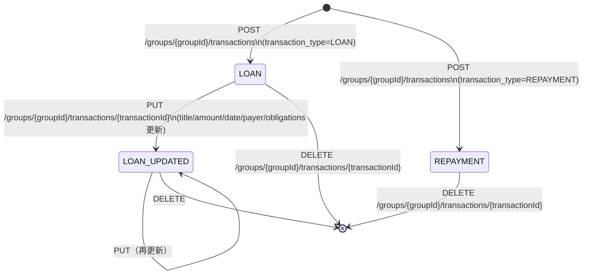

# Design Document (HLD) — transaction

## Step 2 Scope and Ownership Rules

- `design.md` は QA が E2E テストを記述するための唯一の HLD 情報源である。すべての主要フローノードは MySQL の変化と変化しない項目を明記する。
- QA ツールエンベロープ: HTTP クライアント（`restClient`）、DB クライアント（`dbClient`）、ステージング環境。外部依存なし（`TransactionServiceImpl` は外部 API を呼ばない）。
- QA が担当するブランチ: QA ツールエンベロープで再現可能なブランチ（正常作成・詳細取得・更新・削除・履歴・精算・各種バリデーション・リソース不存在・返済更新拒否・為替レート代替）はすべて QA マトリクスに配置する。
- 開発者専用ブランチ: JPA ライフサイクル・DB 制約検証・精算の端数調整ロジックなど内部失敗注入が必要なブランチは開発者マトリクスに移動する。
- 共有シナリオルール: 共有ビジネスシナリオは1回だけ定義し、QA E2E（ステージング）と開発者 Testcontainers ローカルで再利用する。
- QA は `TX-S01..TX-S17` を所有する。開発者専用具体的シナリオは `TX-S18` から続ける。

## Test Asset Shape

- 共有シナリオセット: 操作別 ScenarioTest（`CreateTransactionScenarioTest` / `GetTransactionDetailScenarioTest` / `UpdateTransactionScenarioTest` / `DeleteTransactionScenarioTest` / `GetTransactionHistoryScenarioTest` / `GetTransactionSettlementScenarioTest`）
- QA 自己サービス E2E スイート: E2E executor（ステージング用、別 PR で対応）
- 開発者ローカルセーフティネット: 各 ScenarioTest（Testcontainers + MockMvc）、`TransactionServiceUnitTest`、`TransactionServiceIntegrationTest`

## AC Ownership Matrix

| Requirement / AC | Business trigger | Primary owner repo | Verification entrypoint | Contract / interface | Test owner |
|------------------|------------------|--------------------|-------------------------|----------------------|------------|
| R1-AC1 | 立替取引を作成 | tateca-backend | `POST /groups/{groupId}/transactions` | `groups-groupId-transactions.yaml` | tateca-backend |
| R1-AC2 | 作成後に立替レスポンスを確認 | tateca-backend | `POST /groups/{groupId}/transactions` レスポンス | `groups-groupId-transactions.yaml` | tateca-backend |
| R2-AC1 | 返済取引を作成 | tateca-backend | `POST /groups/{groupId}/transactions` | `groups-groupId-transactions.yaml` | tateca-backend |
| R2-AC2 | 作成後に返済レスポンスを確認 | tateca-backend | `POST /groups/{groupId}/transactions` レスポンス | `groups-groupId-transactions.yaml` | tateca-backend |
| R3-AC1 | 指定日の為替レートが存在する場合 | tateca-backend | `POST /groups/{groupId}/transactions` | `groups-groupId-transactions.yaml` | tateca-backend |
| R3-AC2 | 指定日のレート不在・最新レートで代替 | tateca-backend | `POST /groups/{groupId}/transactions` + DB 確認 | `groups-groupId-transactions.yaml` | tateca-backend |
| R3-AC3 | 通貨コードのレートがシステムに一切不在 | tateca-backend | `POST /groups/{groupId}/transactions` 404 | `groups-groupId-transactions.yaml` | tateca-backend |
| R4-AC1 | 不正入力で取引作成 | tateca-backend | `POST /groups/{groupId}/transactions` 400 | `groups-groupId-transactions.yaml` | tateca-backend |
| R5-AC1 | 存在しない支払者を指定 | tateca-backend | `POST /groups/{groupId}/transactions` 404 | `groups-groupId-transactions.yaml` | tateca-backend |
| R5-AC2 | 存在しないグループを指定 | tateca-backend | `POST /groups/{groupId}/transactions` 404 | `groups-groupId-transactions.yaml` | tateca-backend |
| R5-AC3 | 立替で存在しない義務者を指定 | tateca-backend | `POST /groups/{groupId}/transactions` 404 | `groups-groupId-transactions.yaml` | tateca-backend |
| R5-AC4 | 返済で存在しない受取人を指定 | tateca-backend | `POST /groups/{groupId}/transactions` 404 | `groups-groupId-transactions.yaml` | tateca-backend |
| R6-AC1 | 立替取引の詳細を取得 | tateca-backend | `GET /groups/{groupId}/transactions/{transactionId}` | `groups-groupId-transactions-transactionId.yaml` | tateca-backend |
| R6-AC2 | 返済取引の詳細を取得 | tateca-backend | `GET /groups/{groupId}/transactions/{transactionId}` | `groups-groupId-transactions-transactionId.yaml` | tateca-backend |
| R7-AC1 | 存在しない取引の詳細を取得 | tateca-backend | `GET /groups/{groupId}/transactions/{transactionId}` 404 | `groups-groupId-transactions-transactionId.yaml` | tateca-backend |
| R7-AC2 | 不正入力で詳細取得 | tateca-backend | 各エンドポイント 400 | `groups-groupId-transactions-transactionId.yaml` | tateca-backend |
| R8-AC1 | 立替取引を更新 | tateca-backend | `PUT /groups/{groupId}/transactions/{transactionId}` | `groups-groupId-transactions-transactionId.yaml` | tateca-backend |
| R8-AC2 | 更新後のフィールドを確認 | tateca-backend | `PUT /groups/{groupId}/transactions/{transactionId}` レスポンス | `groups-groupId-transactions-transactionId.yaml` | tateca-backend |
| R8-AC3 | 義務リスト全置換を確認 | tateca-backend | `PUT /groups/{groupId}/transactions/{transactionId}` + DB 確認 | `groups-groupId-transactions-transactionId.yaml` | tateca-backend |
| R8-AC4 | 作成日時が変わらないことを確認 | tateca-backend | `PUT /groups/{groupId}/transactions/{transactionId}` レスポンス | `groups-groupId-transactions-transactionId.yaml` | tateca-backend |
| R9-AC1 | 返済取引の更新を拒否 | tateca-backend | `PUT /groups/{groupId}/transactions/{transactionId}` 400 | `groups-groupId-transactions-transactionId.yaml` | tateca-backend |
| R10-AC1 | 更新時に指定日の為替レートが存在する場合 | tateca-backend | `PUT /groups/{groupId}/transactions/{transactionId}` | `groups-groupId-transactions-transactionId.yaml` | tateca-backend |
| R10-AC2 | 更新時に指定日のレート不在・最新レートで代替 | tateca-backend | `PUT /groups/{groupId}/transactions/{transactionId}` + DB 確認 | `groups-groupId-transactions-transactionId.yaml` | tateca-backend |
| R10-AC3 | 更新時に通貨コードのレートが一切不在 | tateca-backend | `PUT /groups/{groupId}/transactions/{transactionId}` 404 | `groups-groupId-transactions-transactionId.yaml` | tateca-backend |
| R11-AC1 | 不正入力で取引更新 | tateca-backend | `PUT /groups/{groupId}/transactions/{transactionId}` 400 | `groups-groupId-transactions-transactionId.yaml` | tateca-backend |
| R12-AC1 | 存在しない取引の更新 | tateca-backend | `PUT /groups/{groupId}/transactions/{transactionId}` 404 | `groups-groupId-transactions-transactionId.yaml` | tateca-backend |
| R12-AC2 | 更新時に存在しない支払者を指定 | tateca-backend | `PUT /groups/{groupId}/transactions/{transactionId}` 404 | `groups-groupId-transactions-transactionId.yaml` | tateca-backend |
| R12-AC3 | 更新時に存在しない義務者を指定 | tateca-backend | `PUT /groups/{groupId}/transactions/{transactionId}` 404 | `groups-groupId-transactions-transactionId.yaml` | tateca-backend |
| R13-AC1 | 取引と義務を削除 | tateca-backend | `DELETE /groups/{groupId}/transactions/{transactionId}` | `groups-groupId-transactions-transactionId.yaml` | tateca-backend |
| R13-AC2 | 削除後に取引履歴に含まれないことを確認 | tateca-backend | `GET /groups/{groupId}/transactions/history` | `groups-groupId-transactions-history.yaml` | tateca-backend |
| R14-AC1 | 存在しない取引の削除を拒否 | tateca-backend | `DELETE /groups/{groupId}/transactions/{transactionId}` 404 | `groups-groupId-transactions-transactionId.yaml` | tateca-backend |
| R15-AC1 | 取引履歴を降順で取得 | tateca-backend | `GET /groups/{groupId}/transactions/history` | `groups-groupId-transactions-history.yaml` | tateca-backend |
| R15-AC2 | 件数指定で履歴を取得 | tateca-backend | `GET /groups/{groupId}/transactions/history?count=N` | `groups-groupId-transactions-history.yaml` | tateca-backend |
| R15-AC3 | 件数未指定で既定値（5件）を取得 | tateca-backend | `GET /groups/{groupId}/transactions/history` | `groups-groupId-transactions-history.yaml` | tateca-backend |
| R15-AC4 | 取引なし → 空一覧 | tateca-backend | `GET /groups/{groupId}/transactions/history` | `groups-groupId-transactions-history.yaml` | tateca-backend |
| R15-AC5 | 各取引概要のフィールドを確認 | tateca-backend | `GET /groups/{groupId}/transactions/history` レスポンス | `groups-groupId-transactions-history.yaml` | tateca-backend |
| R16-AC1 | 不正入力で履歴取得 | tateca-backend | `GET /groups/{groupId}/transactions/history` 400 | `groups-groupId-transactions-history.yaml` | tateca-backend |
| R17-AC1 | 精算一覧（JPY）を取得 | tateca-backend | `GET /groups/{groupId}/transactions/settlement` | `groups-groupId-transactions-settlement.yaml` | tateca-backend |
| R17-AC2 | 各精算項目のフィールドを確認 | tateca-backend | `GET /groups/{groupId}/transactions/settlement` レスポンス | `groups-groupId-transactions-settlement.yaml` | tateca-backend |
| R17-AC3 | 取引なし → 空精算一覧 | tateca-backend | `GET /groups/{groupId}/transactions/settlement` | `groups-groupId-transactions-settlement.yaml` | tateca-backend |
| R17-AC4 | 全残高ゼロ → 空精算一覧 | tateca-backend | `GET /groups/{groupId}/transactions/settlement` | `groups-groupId-transactions-settlement.yaml` | tateca-backend |
| R18-AC1 | 外貨取引を JPY 換算 | tateca-backend | `GET /groups/{groupId}/transactions/settlement` | `groups-groupId-transactions-settlement.yaml` | tateca-backend |
| R18-AC2 | 複数通貨混在を JPY 換算 | tateca-backend | `GET /groups/{groupId}/transactions/settlement` | `groups-groupId-transactions-settlement.yaml` | tateca-backend |
| R19-AC1 | 端数調整で残高合計ゼロを保証 | tateca-backend | `GET /groups/{groupId}/transactions/settlement` + DB 確認 | `groups-groupId-transactions-settlement.yaml` | tateca-backend |
| R19-AC2 | 精算金額が JPY 整数（四捨五入） | tateca-backend | `GET /groups/{groupId}/transactions/settlement` レスポンス | `groups-groupId-transactions-settlement.yaml` | tateca-backend |
| R19-AC3 | 3人以上循環 → 精算回数最小化 | tateca-backend | `GET /groups/{groupId}/transactions/settlement` | `groups-groupId-transactions-settlement.yaml` | tateca-backend |
| R20-AC1 | 不正入力で精算情報取得 | tateca-backend | `GET /groups/{groupId}/transactions/settlement` 400 | `groups-groupId-transactions-settlement.yaml` | tateca-backend |

## Contract Dependency Order and Step Routing

1. tateca-backend が `contracts/paths/groups-groupId-transactions.yaml` / `groups-groupId-transactions-transactionId.yaml` / `groups-groupId-transactions-history.yaml` / `groups-groupId-transactions-settlement.yaml` を所有し固定する
2. Step 3 (black-box tests) オーナー: tateca-backend（各 ScenarioTest、`TransactionControllerWebTest`）
3. Step 4 (internal tests) オーナー: tateca-backend（`TransactionServiceUnitTest`、`TransactionServiceIntegrationTest`）

## Canonical Testable Flows

### POST /groups/{groupId}/transactions — 取引作成フロー

Convention: HTTP status codes appear only on terminal response nodes. Intermediate nodes describe DB side effects only.

```mermaid
flowchart TD
    A([POST /groups/{groupId}/transactions]) --> B[Step1: DTO deserialize + Bean Validation\nMySQL: no write]
    B -->|invalid| T400[400 VALIDATION.FAILED\nerrors array 存在]
    B -->|Content-Type 不正| T415[415 REQUEST.UNSUPPORTED_MEDIA_TYPE]
    B -->|認証エラー| T401[401 AUTH.*]
    B -->|valid + 認証済み| C[Step2: 為替レート解決\nMySQL: SELECT exchange_rates WHERE currency_code AND date]
    C -->|通貨コードのレートが一切不在| T404EX[404 EXCHANGE_RATE.NOT_FOUND]
    C -->|指定日レート存在| D[Step3: 支払者の存在確認\nMySQL: SELECT users WHERE uuid=payerId]
    C -->|指定日レート不在・最新レートあり| C2[Step2b: 最新レートを指定日付で保存\nMySQL: INSERT INTO exchange_rates\ncurrency_code, date=指定日, exchange_rate=最新レート]
    C2 --> D
    D -->|not found| T404U[404 USER.NOT_FOUND]
    D -->|found| E[Step4: グループの存在確認\nMySQL: SELECT groups WHERE uuid=groupId]
    E -->|not found| T404G[404 GROUP.NOT_FOUND]
    E -->|found| F[Step5: TransactionHistoryEntity save\nMySQL: INSERT INTO transaction_history\nuuid=new, type, title, amount, date, payer, group, exchange_rate\ncreatedAt/updatedAt via @PrePersist]
    F --> G{取引種別}
    G -->|LOAN| H[Step6a: 各義務者の存在確認 + obligation save\nMySQL: SELECT users WHERE uuid=obligorId for each\nINSERT INTO transaction_obligations per obligation\nuuid=new, transaction_uuid, user_uuid, amount]
    H -->|いずれかの義務者 not found| T404OB[404 USER.NOT_FOUND]
    H -->|all found| T201L[201 Created\nTransactionResponse — LOAN\ntransaction_id, type, title, amount, payer\nexchange_rate, date_str, loan.obligations]
    G -->|REPAYMENT| I[Step6b: 受取人の存在確認 + obligation save\nMySQL: SELECT users WHERE uuid=recipientId\nINSERT INTO transaction_obligations\nuuid=new, transaction_uuid, user_uuid=recipient, amount=取引金額]
    I -->|not found| T404RC[404 USER.NOT_FOUND]
    I -->|found| T201R[201 Created\nTransactionResponse — REPAYMENT\ntransaction_id, type, title, amount, payer\nexchange_rate, date_str, repayment.recipient]
```

**Non-gate notes:**
- グループメンバーシップの検証なし。認証済みであれば任意のグループに取引を作成可能。
- 取引金額と義務金額合計の整合性チェックなし。
- 支払者・義務者・受取人がグループメンバーであることの検証なし。

### GET /groups/{groupId}/transactions/{transactionId} — 取引詳細取得フロー

Convention: HTTP status codes appear only on terminal response nodes. Intermediate nodes describe DB side effects only.

```mermaid
flowchart TD
    A([GET /groups/{groupId}/transactions/{transactionId}]) --> B[Step1: パスパラメータ Bean Validation\nMySQL: no write]
    B -->|UUID 形式不正| T400[400 VALIDATION.FAILED]
    B -->|認証エラー| T401[401 AUTH.*]
    B -->|valid + 認証済み| C[Step2: findById transactionId\nMySQL: SELECT transaction_history WHERE uuid=transactionId]
    C -->|not found| T404[404 TRANSACTION.NOT_FOUND]
    C -->|found| D[Step3: findByTransactionId obligations\nMySQL: SELECT transaction_obligations WHERE transaction_uuid=transactionId]
    D --> E{取引種別}
    E -->|LOAN| T200L[200 OK\nTransactionResponse — LOAN\ntransaction_id, type, title, amount, payer\nexchange_rate, date_str, loan.obligations]
    E -->|REPAYMENT| T200R[200 OK\nTransactionResponse — REPAYMENT\ntransaction_id, type, title, amount, payer\nexchange_rate, date_str, repayment.recipient]
```

**Non-gate notes:**
- グループ識別子と取引の所属グループの整合性チェックなし（パスの groupId は使用されない）。

### PUT /groups/{groupId}/transactions/{transactionId} — 取引更新フロー

Convention: HTTP status codes appear only on terminal response nodes. Intermediate nodes describe DB side effects only.

```mermaid
flowchart TD
    A([PUT /groups/{groupId}/transactions/{transactionId}]) --> B[Step1: DTO deserialize + Bean Validation\nMySQL: no write]
    B -->|invalid| T400V[400 VALIDATION.FAILED\nerrors array 存在]
    B -->|Content-Type 不正| T415[415 REQUEST.UNSUPPORTED_MEDIA_TYPE]
    B -->|認証エラー| T401[401 AUTH.*]
    B -->|valid + 認証済み| C[Step2: findById transactionId\nMySQL: SELECT transaction_history WHERE uuid=transactionId]
    C -->|not found| T404TX[404 TRANSACTION.NOT_FOUND]
    C -->|found| D{取引種別チェック}
    D -->|REPAYMENT| T400R[400 REPAYMENT.NOT_UPDATABLE]
    D -->|LOAN| E[Step3: 支払者の存在確認\nMySQL: SELECT users WHERE uuid=payerId]
    E -->|not found| T404U[404 USER.NOT_FOUND]
    E -->|found| F[Step4: 為替レート解決\nMySQL: SELECT exchange_rates WHERE currency_code AND date]
    F -->|通貨コードのレートが一切不在| T404EX[404 EXCHANGE_RATE.NOT_FOUND]
    F -->|指定日レート存在| G[Step5: 既存義務の全削除\nMySQL: DELETE FROM transaction_obligations WHERE transaction_uuid=transactionId]
    F -->|指定日レート不在・最新レートあり| F2[Step4b: 最新レートを指定日付で保存\nMySQL: INSERT INTO exchange_rates\ncurrency_code, date=指定日, exchange_rate=最新レート]
    F2 --> G
    G --> H[Step6: 新しい義務の保存\nMySQL: 各義務者 SELECT users WHERE uuid\nINSERT INTO transaction_obligations per obligation\nuuid=new, transaction_uuid, user_uuid, amount]
    H -->|いずれかの義務者 not found| T404OB[404 USER.NOT_FOUND]
    H -->|all found| I[Step7: TransactionHistoryEntity save\nMySQL: UPDATE transaction_history\ntitle, amount, date, payer, exchange_rate\nupdatedAt via @PreUpdate\ncreatedAt: 変更なし]
    I --> T200[200 OK\nTransactionResponse — LOAN\ntransaction_id, type, title, amount, payer\nexchange_rate, date_str, loan.obligations]
```

**Non-gate notes:**
- グループ識別子と取引の所属グループの整合性チェックなし。
- 取引種別の変更不可（LOAN→REPAYMENT、REPAYMENT→LOAN いずれも不可）。

### DELETE /groups/{groupId}/transactions/{transactionId} — 取引削除フロー

Convention: HTTP status codes appear only on terminal response nodes. Intermediate nodes describe DB side effects only.

```mermaid
flowchart TD
    A([DELETE /groups/{groupId}/transactions/{transactionId}]) --> B[Step1: パスパラメータ Bean Validation\nMySQL: no write]
    B -->|UUID 形式不正| T400[400 VALIDATION.FAILED]
    B -->|認証エラー| T401[401 AUTH.*]
    B -->|valid + 認証済み| C[Step2: findById transactionId\nMySQL: SELECT transaction_history WHERE uuid=transactionId]
    C -->|not found| T404[404 TRANSACTION.NOT_FOUND]
    C -->|found| D[Step3: findByTransactionId → deleteAllById\nMySQL: DELETE FROM transaction_obligations WHERE transaction_uuid=transactionId]
    D --> E[Step4: deleteById transactionId\nMySQL: DELETE FROM transaction_history WHERE uuid=transactionId]
    E --> T204[204 No Content]
```

**Non-gate notes:**
- グループ識別子と取引の所属グループの整合性チェックなし。
- R14-AC1（存在しない取引の削除 → 404）は `TransactionServiceImpl.deleteTransaction` に `findById` 存在確認を追加することで実装される。現状（`deleteById` のみ）では 204 が返るが、この design.md の記述は意図した仕様を示す。

### GET /groups/{groupId}/transactions/history — 取引履歴取得フロー

Convention: HTTP status codes appear only on terminal response nodes. Intermediate nodes describe DB side effects only.

```mermaid
flowchart TD
    A([GET /groups/{groupId}/transactions/history]) --> B[Step1: パスパラメータ Bean Validation\nMySQL: no write]
    B -->|UUID 形式不正| T400[400 VALIDATION.FAILED]
    B -->|認証エラー| T401[401 AUTH.*]
    B -->|valid + 認証済み| C[Step2: findTransactionsByGroupWithLimit\nMySQL: SELECT transaction_history WHERE group_uuid=groupId\nORDER BY created_at DESC LIMIT count]
    C -->|0件（取引なし or グループ不存在）| T200E[200 OK\nTransactionHistoryResponse — transactions_history: []]
    C -->|1件以上| T200[200 OK\nTransactionHistoryResponse — 取引概要リスト（降順）\n各エントリ: transaction_id, type, title, amount, exchange_rate, date]
```

**Non-gate notes:**
- グループの存在確認なし。存在しない groupId の場合も空リストを返す。
- 件数バリデーションなし（0以下・極端に大きい値も SQL LIMIT に渡される）。

### GET /groups/{groupId}/transactions/settlement — 精算情報取得フロー

Convention: HTTP status codes appear only on terminal response nodes. Intermediate nodes describe DB side effects only.

```mermaid
flowchart TD
    A([GET /groups/{groupId}/transactions/settlement]) --> B[Step1: パスパラメータ Bean Validation\nMySQL: no write]
    B -->|UUID 形式不正| T400[400 VALIDATION.FAILED]
    B -->|認証エラー| T401[401 AUTH.*]
    B -->|valid + 認証済み| C[Step2: findByGroupUuidWithUserDetails\nMySQL: SELECT user_groups JOIN users WHERE group_uuid=groupId]
    C -->|0件（グループ不存在 or メンバーなし）| T200E[200 OK\nTransactionSettlementResponse — transactions_settlement: []]
    C -->|1件以上| D[Step3: findByGroupId obligations\nMySQL: SELECT transaction_obligations JOIN transaction_history\nWHERE group_uuid=groupId]
    D --> E[Step4: 各メンバーの残高計算\n義務金額を exchange_rate で JPY 換算\n義務者は +amount（借り）、支払者は -amount（貸し）\nMySQL: no write]
    E --> F[Step5: 端数調整\n残高合計 ≠ 0 の場合: 最大債務者の残高を残差分調整\nMySQL: no write]
    F --> G[Step6: 精算最適化\n债务者・債権者を金額順に優先キューで組み合わせ\n送金回数最小化\nMySQL: no write]
    G -->|全残高ゼロ| T200E2[200 OK\nTransactionSettlementResponse — transactions_settlement: []]
    G -->|精算あり| T200[200 OK\nTransactionSettlementResponse\n各エントリ: from（債務者）, to（債権者）, amount（JPY, 四捨五入）]
```

**Non-gate notes:**
- グループの存在確認なし。存在しない groupId の場合も空リストを返す。

## External Integration Flows

本フィーチャーは外部 API 呼び出しを行わない。Firebase 認証は `TatecaAuthenticationFilter`（リクエストフィルター）が担当し、`TransactionServiceImpl` は呼ばない。MySQL（`transaction_history` / `transaction_obligations` / `users` / `groups` / `user_groups` / `exchange_rates` テーブル）のみを使用する。

## State Model



取引種別は作成後に変更できない。REPAYMENT は更新不可（400）。

## Assertion Rules For Test Authors

- **為替レート解決の条件分岐:** `exchange_rates` テーブルに `(currency_code, date)` のペアが存在する場合はそのレートを使用。指定日のレートが不在でも同通貨コードの最新レートが存在する場合は、最新レートを指定日付でコピーして `exchange_rates` に INSERT し、そのエントリを使用する。いずれの為替レートも存在しない場合は 404 を返す。
- **返済取引の更新拒否:** `TransactionServiceImpl.updateTransaction` は取引種別が REPAYMENT の場合に `IllegalArgumentException` を投げる。`GlobalExceptionHandler` は `IllegalArgumentException` を 400 にマッピングする。`error_code` は `VALIDATION.FAILED` ではなく独自メッセージを含む 400 として返される（`REPAYMENT.NOT_UPDATABLE` という専用 error_code は現行実装に存在しないため、Controller Web Test では `status().isBadRequest()` のみアサートする）。
- **取引削除の存在確認:** R14-AC1 に従い `deleteTransaction` は `findById` で存在確認を行った後に削除する。存在しない取引には 404 を返す（実装変更が必要）。
- **取引削除のアトミック性:** `deleteAllById（obligations）` → `deleteById（transaction_history）` の順で削除される。同一 `@Transactional` スコープ内で実行される。
- **取引更新の義務全置換:** `updateTransaction` は `deleteAllByTransactionId` で既存義務をすべて削除してから新しい義務を INSERT する。`created_at` は `@PrePersist` で設定済みのため変更されない。`updated_at` は `@PreUpdate` で更新される。
- **取引履歴のソート:** `findTransactionsByGroupWithLimit` は `created_at DESC` で並び替えて LIMIT を適用する。新しい取引ほど先頭に来る。件数デフォルト値は `@RequestParam(defaultValue = "5")`。
- **精算の端数調整:** `applyFinalBalanceAdjustment` が全メンバーの残高合計を計算し、ゼロでない場合に最大債務者（正の残高が最大）の残高を残差分だけ調整する。残差は為替換算の丸めにより発生する。
- **精算金額の四捨五入:** `processTransactions` で `minAmount.setScale(0, RoundingMode.HALF_UP).longValue()` を使用。精算金額は JPY 整数値。
- **グループ不存在時の動作:** `getTransactionHistory` と `getSettlements` はグループ存在確認を行わない。存在しない `groupId` でも空リストを返す。
- **外部→内部エラー変換:** `EntityNotFoundException` → 404 (`AUTH_USER.NOT_FOUND`, `USER.NOT_FOUND`, `GROUP.NOT_FOUND` など)。現行実装では transaction 専用の `TRANSACTION.NOT_FOUND` error_code が `ErrorCode` enum に定義されていないため、`EntityNotFoundException` のメッセージ文字列がそのまま使用される（R14 実装後に `TRANSACTION_NOT_FOUND` error code の追加が推奨される）。
- **versioned-row:** `transaction_history` / `transaction_obligations` テーブルに `version` カラムなし。楽観ロックなし。
- **post-success rollback:** 外部 API なし。該当なし。

## QA E2E Matrix

| QA E2E method | Source | Staging prerequisite or harness | Response checks | DB checks |
|---------------|--------|--------------------------------|-----------------|-----------|
| `txS01_r1Ac1_createLoanAndVerify` | TX-S01 / R1-AC1 | 認証ユーザー・グループ・JPY 為替レート作成済み | `201` / `transaction_id` 存在 / `transaction_type == LOAN` | `transaction_history` INSERT |
| `txS02_r1Ac2_loanResponseFields` | TX-S02 / R1-AC2 | 同上 | `201` / `payer.uuid` / `exchange_rate.currency_code` / `loan.obligations` 存在 | `transaction_obligations` INSERT |
| `txS03_r2Ac1_createRepaymentAndVerify` | TX-S03 / R2-AC1 | 認証ユーザー・グループ・JPY 為替レート作成済み | `201` / `transaction_type == REPAYMENT` | `transaction_history` INSERT |
| `txS04_r2Ac2_repaymentResponseFields` | TX-S04 / R2-AC2 | 同上 | `201` / `repayment.recipient.uuid` 存在 | `transaction_obligations` INSERT |
| `txS05_r3Ac2_exchangeRateFallback` | TX-S05 / R3-AC2 | JPY レートあり・指定日のレートなし | `201` | `exchange_rates` に代替レートが INSERT されていること |
| `txS06_r6Ac1_getLoanTransactionDetail` | TX-S06 / R6-AC1 | 立替取引作成済み | `200` / `loan.obligations` 存在 | — |
| `txS07_r6Ac2_getRepaymentTransactionDetail` | TX-S07 / R6-AC2 | 返済取引作成済み | `200` / `repayment.recipient` 存在 | — |
| `txS08_r8Ac1Ac2Ac3_updateLoanTransaction` | TX-S08 / R8-AC1, R8-AC2, R8-AC3 | 立替取引作成済み | `200` / 更新後フィールド反映 / obligations 置換 | `transaction_obligations` 旧レコード削除・新レコード INSERT |
| `txS09_r8Ac4_createdAtUnchanged` | TX-S09 / R8-AC4 | 立替取引作成済み | `200` / `created_at` 変化なし | `transaction_history.created_at` 変化なし |
| `txS10_r13Ac1_deleteTransactionAndObligations` | TX-S10 / R13-AC1 | 立替取引作成済み | `204` | `transaction_history` + `transaction_obligations` 削除確認 |
| `txS11_r13Ac2_deletedTransactionNotInHistory` | TX-S11 / R13-AC2 | 取引削除済み | 履歴 `200` / 削除済み取引 ID が含まれていないこと | — |
| `txS12_r15Ac1_historyInDescendingOrder` | TX-S12 / R15-AC1 | 複数取引作成済み | `200` / `transactions_history` が `created_at` 降順 | — |
| `txS13_r15Ac2Ac3_historyCountLimit` | TX-S13 / R15-AC2, R15-AC3 | 取引7件作成済み | count=2 → 2件 / count未指定 → 5件 | — |
| `txS14_r15Ac4_emptyHistoryWhenNoTransactions` | TX-S14 / R15-AC4 | 取引なし | `200` / `transactions_history: []` | — |
| `txS15_r17Ac1Ac2_settlementListInJpy` | TX-S15 / R17-AC1, R17-AC2 | 立替取引あり | `200` / `from.uuid` / `to.uuid` / `amount > 0` | — |
| `txS16_r17Ac3Ac4_emptySettlement` | TX-S16 / R17-AC3, R17-AC4 | 取引なし or 全残高ゼロ | `200` / `transactions_settlement: []` | — |
| `txS17_r18Ac1_foreignCurrencySettlement` | TX-S17 / R18-AC1 | 外貨取引あり | `200` / 精算金額が JPY 整数 | — |

## QA Contract E2E Matrix

| QA contract E2E method | Source | Staging prerequisite or harness | Response checks | DB checks |
|------------------------|--------|--------------------------------|-----------------|-----------|
| `shouldReturn400WhenCreateTransactionInvalidInput` | R4-AC1 / `VALIDATION.FAILED` | — | `400` / `$.error_code == "VALIDATION.FAILED"` | no write |
| `shouldReturn415WhenCreateTransactionNoContentType` | `REQUEST.UNSUPPORTED_MEDIA_TYPE` | — | `415` / `$.error_code == "REQUEST.UNSUPPORTED_MEDIA_TYPE"` | no write |
| `shouldReturn404WhenCreateTransactionExchangeRateNotFound` | R3-AC3 / `EXCHANGE_RATE.NOT_FOUND` | 通貨コードのレート未登録 | `404` | no write |
| `shouldReturn404WhenCreateTransactionPayerNotFound` | R5-AC1 / `USER.NOT_FOUND` | 存在しない payerId | `404` | no write |
| `shouldReturn404WhenCreateTransactionGroupNotFound` | R5-AC2 / `GROUP.NOT_FOUND` | 存在しない groupId | `404` | no write |
| `shouldReturn404WhenCreateTransactionObligorNotFound` | R5-AC3 / `USER.NOT_FOUND` | 存在しない義務者 | `404` | no write |
| `shouldReturn404WhenCreateTransactionRecipientNotFound` | R5-AC4 / `USER.NOT_FOUND` | 存在しない受取人 | `404` | no write |
| `shouldReturn404WhenGetTransactionDetailNotFound` | R7-AC1 / `TRANSACTION.NOT_FOUND` | 存在しない transactionId | `404` | no write |
| `shouldReturn400WhenGetTransactionDetailInvalidUuid` | R7-AC2 / `VALIDATION.FAILED` | 不正 UUID | `400` | no write |
| `shouldReturn400WhenUpdateTransactionRepayment` | R9-AC1 / 400 | 返済取引あり | `400` | no write |
| `shouldReturn404WhenUpdateTransactionNotFound` | R12-AC1 / `TRANSACTION.NOT_FOUND` | 存在しない transactionId | `404` | no write |
| `shouldReturn404WhenUpdateTransactionPayerNotFound` | R12-AC2 / `USER.NOT_FOUND` | 存在しない payerId | `404` | no write |
| `shouldReturn404WhenUpdateTransactionObligorNotFound` | R12-AC3 / `USER.NOT_FOUND` | 存在しない義務者 | `404` | no write |
| `shouldReturn404WhenUpdateTransactionExchangeRateNotFound` | R10-AC3 / `EXCHANGE_RATE.NOT_FOUND` | 通貨コードのレート未登録 | `404` | no write |
| `shouldReturn404WhenDeleteTransactionNotFound` | R14-AC1 / `TRANSACTION.NOT_FOUND` | 存在しない transactionId | `404` | no write |
| `shouldReturn400WhenDeleteTransactionInvalidUuid` | R15-AC1 / `VALIDATION.FAILED` | 不正 UUID | `400` | no write |
| `shouldReturn400WhenGetHistoryInvalidGroupId` | R16-AC1 / `VALIDATION.FAILED` | 不正 UUID | `400` | no write |
| `shouldReturn400WhenGetSettlementInvalidGroupId` | R20-AC1 / `VALIDATION.FAILED` | 不正 UUID | `400` | no write |

## Developer Verification Policy

### Shared Scenario Mirroring

QA E2E マトリクスが共有ビジネス動作の唯一の正規シナリオマトリクスである。QA が所有するすべての共有シナリオ（TX-S01..TX-S17）は Testcontainers + MockMvc を使用してローカルでも実行可能であり、同じレスポンス・MySQL アウトカムを証明しなければならない。

### Dev-Only Verification

| Scenario ID | Verification item | Why it is developer-owned | Expected local proof |
|-------------|-------------------|---------------------------|----------------------|
| TX-S18 | JPA `@PrePersist` が `transaction_history.createdAt` / `updatedAt` を設定すること | 実 DB・JPA ライフサイクルが必要 | `TransactionServiceIntegrationTest` |
| TX-S19 | JPA `@PreUpdate` が `transaction_history.updatedAt` を更新すること（取引更新時） | 実 DB・JPA ライフサイクルが必要 | `TransactionServiceIntegrationTest` |
| TX-S20 | 義務削除 + 取引削除のアトミック性（トランザクション境界） | DB 障害注入が必要 | `TransactionServiceIntegrationTest` |
| — | `TransactionServiceImpl` 各メソッドの分岐（NOT_FOUND・REPAYMENT拒否・為替レート代替など）の例外スロー確認 | モック注入が必要 | `TransactionServiceUnitTest` |
| — | 全 OpenAPI エラーコードのマッピング（`VALIDATION.FAILED` / `USER.NOT_FOUND` / `GROUP.NOT_FOUND` / `EXCHANGE_RATE.NOT_FOUND` など）| ExceptionHandler マッピングは Controller Web Test で網羅 | `TransactionControllerWebTest` |
| — | 精算の端数調整ロジック（`applyFinalBalanceAdjustment`）の数値検証 | 複数の外貨レートと精密な端数計算が必要 | `TransactionServiceUnitTest` |

### Local Proof Selection Rule

- **共有シナリオ（TX-S01..TX-S17）:** 各 ScenarioTest（Testcontainers + MockMvc）
- **コントラクト・バリデーション・エラーマッピング:** `TransactionControllerWebTest`（`@WebMvcTest`）
- **ドメインロジック分岐:** `TransactionServiceUnitTest`（Mockito）
- **DB 永続化・JPA ライフサイクル・トランザクション境界:** `TransactionServiceIntegrationTest`（Testcontainers）

## Data Model Decisions

- `transaction_history` テーブル: `uuid`（PK, BINARY(16)）/ `transaction_type`（ENUM）/ `group_uuid`（FK, updatable=false）/ `title`（varchar(50)）/ `amount`（int, 通貨最小単位）/ `currency_code` + `exchange_rate_date`（FK to exchange_rates, 複合）/ `transaction_date`（Instant）/ `payer_id`（FK to users）/ `created_at` / `updated_at`（@PrePersist / @PreUpdate）
- `transaction_obligations` テーブル: `uuid`（PK, BINARY(16)）/ `transaction_uuid`（FK, updatable=false）/ `user_uuid`（FK to users）/ `amount`（int）/ `created_at` / `updated_at`
- 義務の全置換は `deleteAllByTransactionId` + 新規 `saveAll` で実装。中間テーブルを使いオブリゲーションのレコードを置き換える。
- `exchange_rates` テーブル: `(currency_code, date)` 複合 PK。為替レート代替時は最新レートの `date` のみ指定日に変更した新レコードを INSERT する。
- `version` カラムなし（楽観ロックなし）。
- `TRANSACTION.NOT_FOUND` error_code は現行の `ErrorCode` enum に未定義。R14 実装時に `TRANSACTION_NOT_FOUND("TRANSACTION.NOT_FOUND", "Transaction not found")` の追加が必要。
